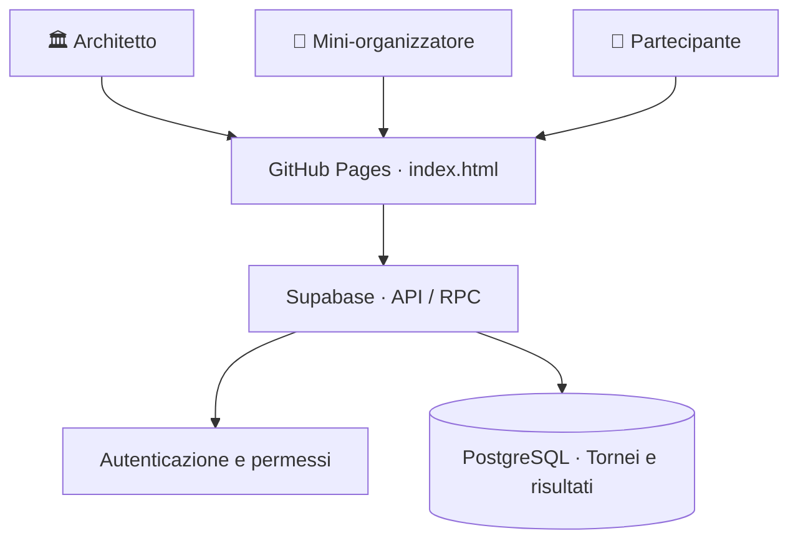

<div align="center">

# 🏐🎾 Tornei Beach e Padel

### Una piattaforma web per organizzare tornei di beach volley e padel.

**Calendari intelligenti · Classifiche in tempo reale · Gironi e playoff · Più tornei, un solo sito**


*Un progetto nato per semplificare l'organizzazione dei tornei amatoriali, dal primo abbinamento fino alla premiazione.*

</div>

---

## 📖 Il progetto

**Beach Torneo** è una web app responsive per pianificare e gestire tornei **2 contro 2** di beach volley e padel.

Non è soltanto un tabellone: genera calendari cercando di distribuire equamente le partite, rispettare le disponibilità dei partecipanti, alternare compagni e avversari e limitare le attese. Durante il torneo permette di registrare risultati, aggiornare classifiche, gestire imprevisti e condividere tutto tramite un link pubblico.

La piattaforma supporta **più tornei indipendenti** e separa chiaramente chi organizza da chi consulta i risultati.

> **🌐 Sito online:** il collegamento GitHub Pages può essere aggiunto al campo **Website** nella sezione *About* di questo repository.

## ✨ Funzionalità principali

| Area | Cosa offre |
| --- | --- |
| 🗓️ **Calendari** | Generazione automatica e ottimizzazione di abbinamenti, turni, campi e riposi |
| 👥 **Partecipanti** | Anagrafica, disponibilità orarie e riepilogo delle partite individuali |
| 🔀 **Formati** | Baraonda libera, baraonda mista, coppie fisse, gironi all'italiana e playoff |
| ⚖️ **Equità** | Partite valide bilanciate, gestione delle presenze extra fuori classifica, riduzione di compagni e avversari ripetuti |
| 🔄 **Imprevisti** | Riorganizzazione dei soli turni futuri conservando partite e risultati già confermati |
| 🏆 **Classifiche** | Aggiornamento automatico, criteri di spareggio, qualificazioni e tabellone a eliminazione diretta |
| 🎾 **Padel** | Incontri a tempo, set da 4 o 6 game, meglio dei tre set, tie-break e super tie-break |
| 🏐 **Beach volley** | Incontri a tempo, a punti fissi o set unico, con regole di validazione dedicate |
| 🌐 **Condivisione** | Link distinto per ogni torneo e consultazione pubblica in sola lettura |
| 💾 **Dati** | Sincronizzazione online, backup JSON, ripristino e stampe del calendario e delle classifiche |

L'interfaccia è progettata sia per **desktop** sia per **smartphone**, con tema chiaro/scuro.

## 🏟️ Formati di torneo

### Baraonda / Giranome

Le coppie cambiano tra una partita e l'altra. Il generatore prova a distribuire in modo equo le gare valide, differenziare compagni e avversari ed evitare troppe partite consecutive.

Nella **baraonda mista** privilegia gli incontri equilibrati per genere, compatibilmente con il numero di iscritti e i vincoli disponibili.

### Coppie fisse

Le squadre restano invariate. È possibile organizzare un torneo regolare oppure una formula con **gironi + fase finale a eliminazione diretta**, comprensiva di qualificazioni, avanzamento automatico e, quando prevista, finale 3°/4° posto.

### Punteggi specifici per sport

- **Beach volley:** risultati a tempo (anche con pareggio), punteggio obiettivo e set unico.
- **Padel:** game a tempo (pareggio ammesso), set singolo e meglio dei tre; configurazione differenziata per gironi e fasi finali.

Le classifiche sono basate sui risultati registrati e applicano i criteri di spareggio previsti dal formato selezionato.

## 🔐 Ruoli e permessi

Un unico sito ospita più tornei, ciascuno con i propri dati e il proprio link.

| Operazione | 🏛️ Architetto | 🔑 Organizzatore del torneo | 👀 Partecipante |
| --- | :---: | :---: | :---: |
| Consultare calendario e risultati | ✅ | ✅ | ✅ |
| Inserire risultati e modificare turni | ✅ | ✅ | ❌ |
| Gestire i partecipanti del torneo | ✅ | ✅ | ❌ |
| Gestire altri tornei | ✅ | ❌ | ❌ |
| Creare, archiviare o eliminare tornei | ✅ | ❌ | ❌ |
| Assegnare o cambiare password dei tornei | ✅ | ❌ | ❌ |

- **Architetto:** account amministratore globale autenticato tramite **Supabase Auth**.
- **Mini-organizzatore:** accesso tramite una password dedicata *a un solo torneo*.
- **Partecipante:** accesso pubblico in **sola lettura**, senza registrazione.

Un torneo archiviato rimane consultabile, ma non è modificabile dal mini-organizzatore. L'eliminazione definitiva è riservata all'Architetto.

## 🧩 Architettura



| Componente | Tecnologia |
| --- | --- |
| Interfaccia | HTML5, CSS3 e JavaScript vanilla |
| Pubblicazione | GitHub Pages (hosting statico HTTPS) |
| Database | PostgreSQL su Supabase |
| Autenticazione | Supabase Auth per l'Architetto; sessioni limitate al torneo per gli organizzatori |
| Autorizzazioni | Row Level Security e funzioni PostgreSQL RPC |
| Distribuzione | Un singolo `index.html`, senza framework frontend o processo di build |

I link pubblici distinguono i tornei tramite un parametro nell'URL, ad esempio:

```text
https://<utente>.github.io/<repository>/?torneo=padel-open-1
```

*Il link è illustrativo: ogni torneo riceve il proprio identificativo quando viene creato.*

### ⚡ Sincronizzazione V11.1

La piattaforma usa un **numero di revisione per torneo**:

1. Il partecipante controlla periodicamente se la revisione è cambiata (circa ogni **12 secondi**).
2. Il calendario e i risultati completi vengono scaricati soltanto in presenza di aggiornamenti.
3. Le modifiche vengono salvate tramite un'operazione **atomica** che comprende stato del torneo e punteggi.
4. Se un altro organizzatore ha già aggiornato il torneo, il salvataggio obsoleto viene rifiutato. L'app segnala il conflitto e consente di salvare un backup locale prima di ricaricare la versione online.

Questo approccio limita il traffico inutile e riduce il rischio di sovrascritture silenziose. **I conflitti non vengono uniti automaticamente**: richiedono una verifica dell'organizzatore.

## 🚀 Utilizzo e pubblicazione

### Per i partecipanti

Aprire il link pubblico del torneo dal browser: **non servono installazioni, account o password**. Calendario e classifiche sono consultabili anche da smartphone.

### Per gli organizzatori

Aprire il link del proprio torneo e scegliere l'accesso organizzatore. Dopo l'autenticazione è possibile gestire iscritti, calendari e risultati, nei limiti del ruolo assegnato.

### Per pubblicare una propria istanza

Il frontend è statico, ma le funzionalità condivise richiedono un progetto **Supabase** configurato con le tabelle, le funzioni RPC e i permessi necessari.

1. Preparare un progetto Supabase e installare lo schema compatibile con **V11.1** (installazione V11 + aggiornamento V11.1 se si parte da un database vuoto).
2. Creare tramite Supabase Auth l'utente amministratore e associarlo al ruolo di **Architetto**.
3. Configurare `index.html` con **Project URL** e **Publishable key** pubblica.
4. Pubblicare `index.html` nel repository e abilitare GitHub Pages sul ramo e sulla cartella corretti.
5. Accedere come Architetto, creare un torneo di prova e verificare l'accesso in sola lettura da una finestra privata.

> [!IMPORTANT]
> **Non inserire mai password, token di sessione, `service_role` o secret key nel repository.** La Publishable key è destinata al codice client, ma la sicurezza dipende anche dalle autorizzazioni correttamente applicate nel database.

Per la sola generazione locale dei calendari il programma può funzionare senza pubblicazione; la condivisione dei dati fra dispositivi richiede invece il backend online.

## 🧪 Qualità e test

Il progetto è stato verificato iterativamente tramite test nel browser e simulazioni di diverse configurazioni di torneo.

Nella **V11.1** una suite automatica basata su **Python + Playwright** ha superato **25 verifiche su 25** nell'ambiente di prova, includendo:

- Generazione dei turni e gestione dei gironi/playoff;
- Punteggi beach e padel, inclusi tie-break e super tie-break;
- Separazione dei permessi tra tornei;
- Polling leggero e controllo delle revisioni;
- Salvataggi concorrenti, rilevazione dei conflitti e backup;
- Controlli dell'interfaccia mobile.

**Nota:** i test delle API sono stati eseguiti con un backend simulato. Non costituiscono un audit di sicurezza né sostituiscono il collaudo di Supabase reale e i test durante tornei effettivi.

## 🛣️ Evoluzione del progetto

| Versioni | Traguardo |
| --- | --- |
| V1–V5 | Generazione e ottimizzazione dei calendari |
| V6–V7 | Backup, stampe, rigenerazione parziale e restyling responsive |
| V8 | Supporto multi-sport: beach volley e padel |
| V9–V9.1 | Consolidamento, validazione punteggi e test automatici |
| V10 | Gestione di più tornei indipendenti |
| V11 | Dashboard Architetto, ruoli, link pubblici, archiviazione |
| **V11.1** | **Polling efficiente, salvataggi atomici e protezione dai conflitti** |

### Possibili miglioramenti futuri

- [ ] Rafforzare ulteriormente il rate limiting degli accessi organizzatore lato server.
- [ ] Sostituire gradualmente i riferimenti ai giocatori basati sui nomi con ID stabili.
- [ ] Ampliare i test di integrazione su un database Supabase reale.
- [ ] Consolidare il CSS e migliorare ulteriormente l'accessibilità.

Questi elementi sono **sviluppi possibili**, non funzionalità già disponibili.

## ⚠️ Stato del progetto

**Versione 11.1 — in evoluzione.** Il progetto è pensato principalmente per tornei amatoriali. Prima di un evento importante è consigliabile fare un torneo di prova, verificare gli accessi da dispositivi differenti ed esportare un backup JSON.

I dati pubblici dei tornei sono consultabili dai partecipanti: evitare di inserire informazioni personali riservate nelle note o nei campi pubblici.

## 📄 Licenza

Non è stata ancora definita una licenza open source per il repository. Prima di consentire il riutilizzo o la ridistribuzione del codice, scegliere e aggiungere un file `LICENSE` appropriato.

---

<div align="center">

**Pensato per stare meno tempo sui fogli di calcolo e più tempo in campo.** 🏐🎾

</div>
